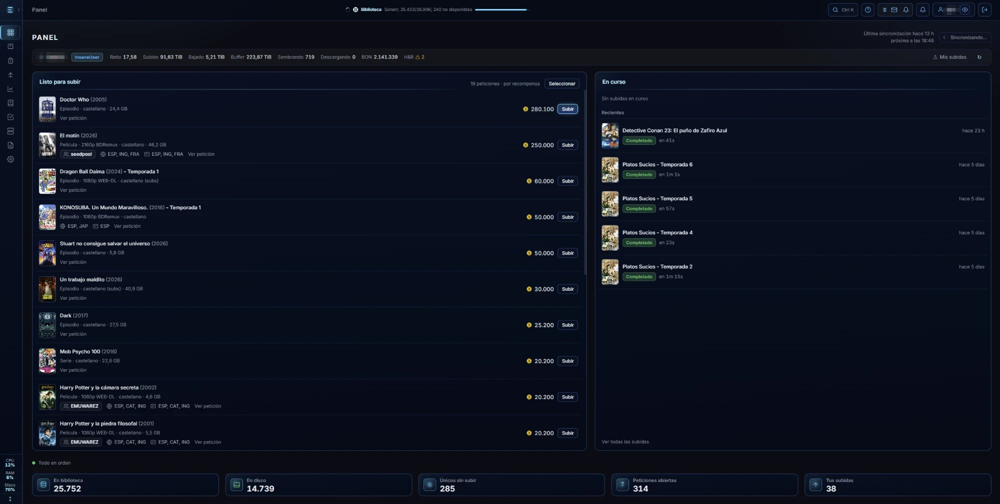
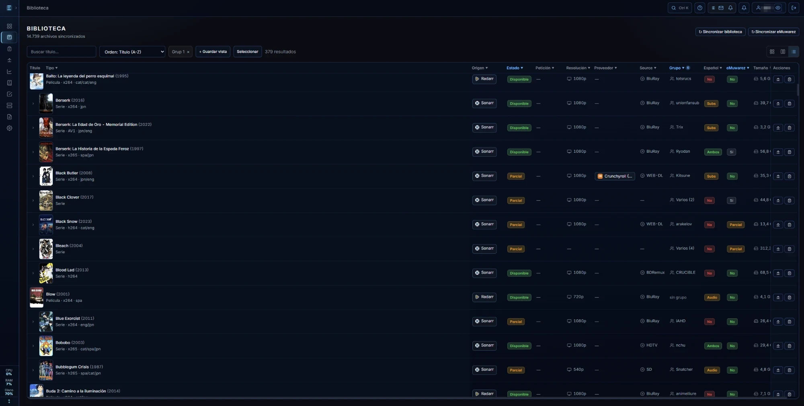
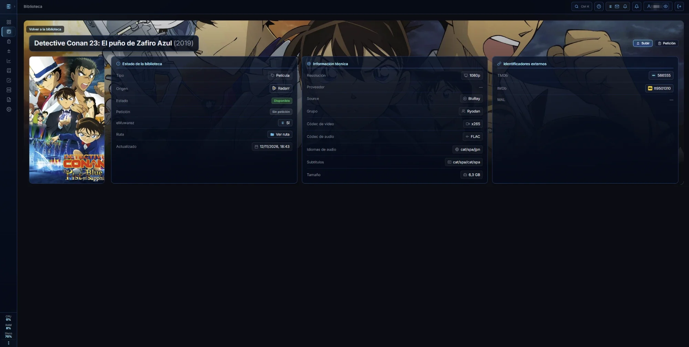
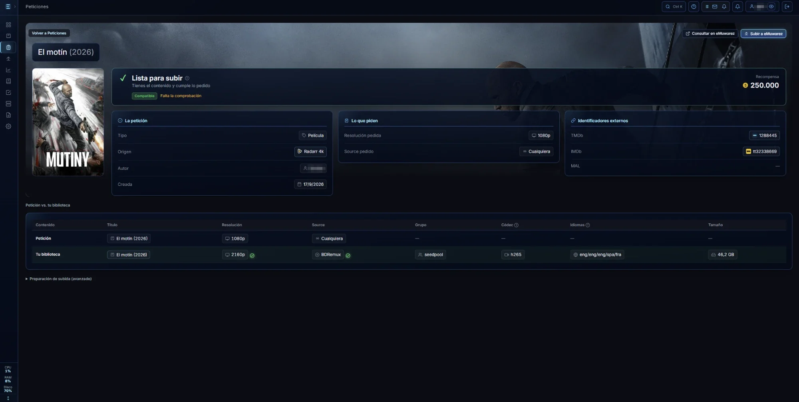
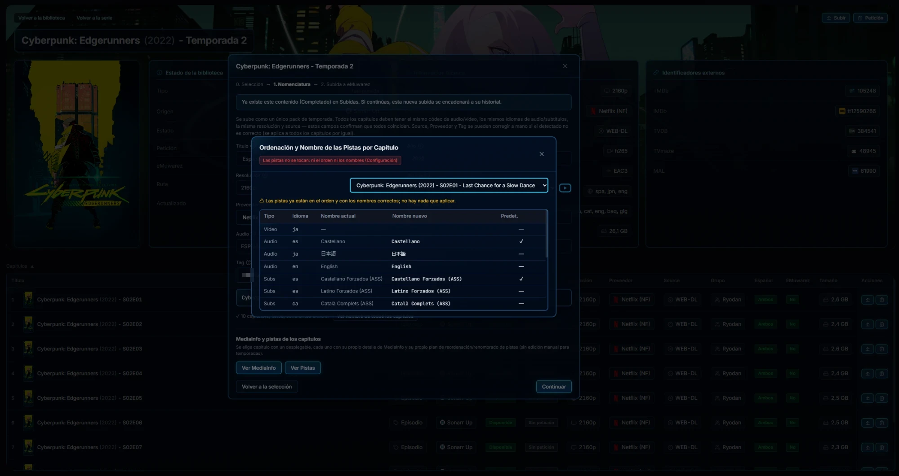
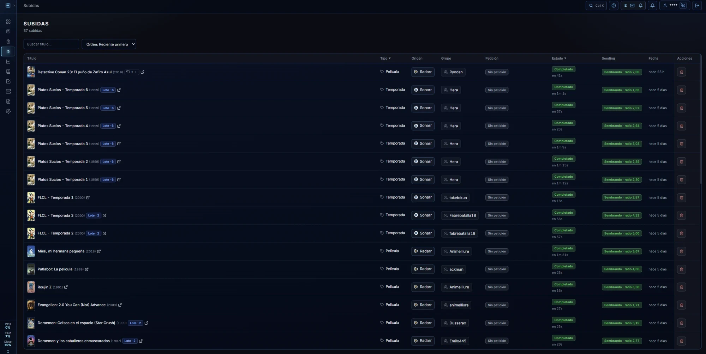
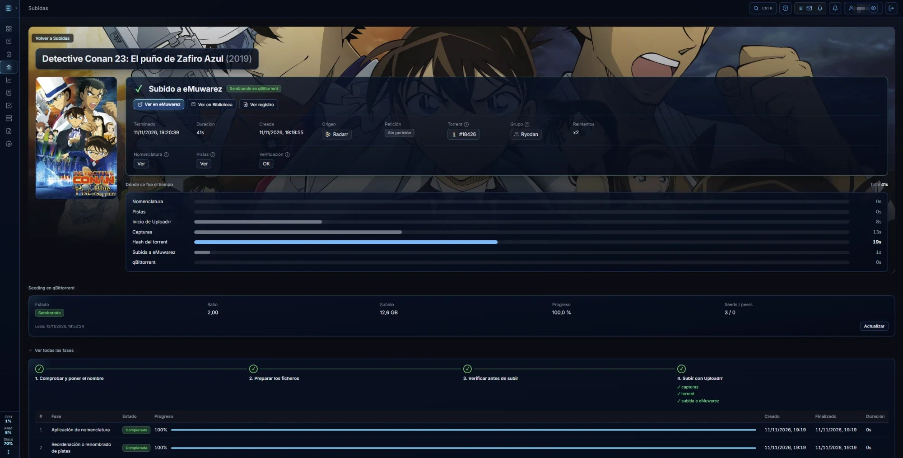
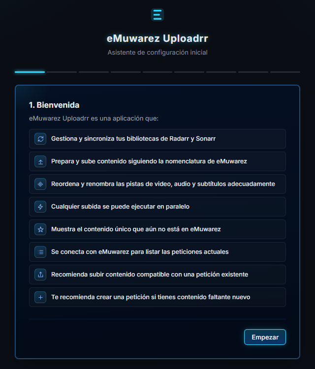
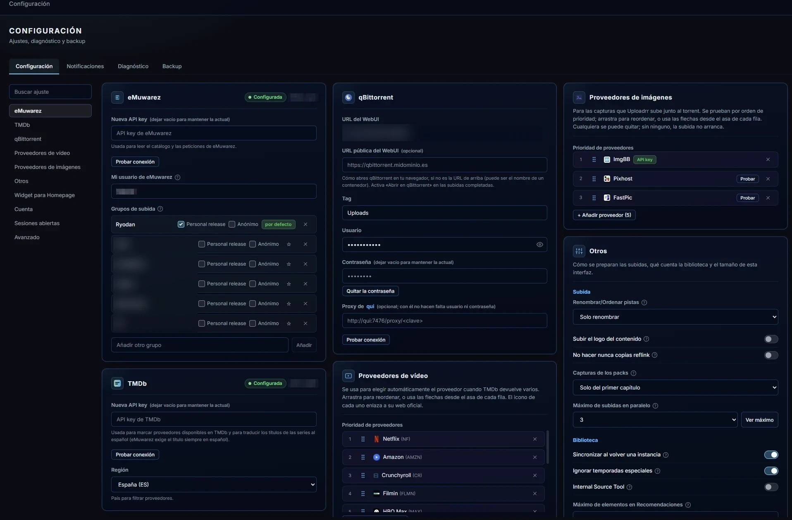

# eMuwarr

[](https://github.com/Kisnov/eMuwarr/actions/workflows/ci.yml)
[](https://github.com/Kisnov/eMuwarr/actions/workflows/publicar.yml)
[](https://github.com/Kisnov/eMuwarr/actions/workflows/zizmor.yml)
[](https://github.com/Kisnov/eMuwarr/security/code-scanning)
[](https://github.com/Kisnov/eMuwarr/actions/workflows/bundle.yml)
[](https://app.codecov.io/gh/Kisnov/eMuwarr/tree/dev)
[](.coderabbit.yaml)
[](.github/dependabot.yml)
[](https://github.com/users/Kisnov/packages/container/package/emuwarr)
[](https://github.com/Kisnov/eMuwarr/pkgs/container/emuwarr/versions?filters%5Bversion_type%5D=tagged)
[](pyproject.toml)
[](frontend/package.json)

Aplicación web autoalojada para subir a **[eMuwarez](https://emu-warez.com)** lo que ya tienes en **Radarr** y
**Sonarr**. Te dice qué puedes subir, pone el nombre que pide el tracker, sube el torrent y lo deja sembrando en
qBittorrent. Todo desde el navegador.



**En esta página:** [Cómo funciona](#cómo-funciona) · [Qué necesitas](#qué-necesitas) ·
[Pantallas](#pantallas) · [Arranque rápido](#arranque-rápido-docker-compose) ·
[Rutas](#rutas-lo-único-delicado) · [Versiones](#versiones-y-volver-atrás) · [Sin Docker](#uso-sin-docker) ·
[Desarrollo](#desarrollo)

## Cómo funciona

1. **Sincroniza** tu biblioteca de Radarr y Sonarr, el catálogo de eMuwarez y sus peticiones abiertas.
2. **Cruza** las tres cosas: qué tienes que no está en el tracker, y qué peticiones puedes cubrir (con su recompensa).
3. **Prepara** la subida: genera el nombre con la nomenclatura de eMuwarez, revisa las pistas y enlaza los ficheros
   en una carpeta de subidas, sin tocar los nombres de tu biblioteca.
4. **Sube** con [Uploadrr-EMU](uploadrr-emu/), que va dentro de la imagen: capturas,
   torrent, subida a eMuwarez y alta en qBittorrent, con el progreso en directo.

## Qué necesitas

- Un equipo con **Docker** (24+ con Compose v2). La imagen lleva todo lo demás.
- **Radarr** y/o **Sonarr** con tu biblioteca.
- Una cuenta de **eMuwarez** con su API key, y una API key de **TMDb** (gratuita).
- **qBittorrent**, que vea la carpeta de subidas en la misma ruta que este contenedor.
- La media y la carpeta de subidas en el **mismo sistema de ficheros**, para que la subida sea un enlace duro y no
  ocupe el doble.

Las claves se ponen en el asistente web la primera vez que entras; no van en ningún fichero.

## Pantallas

### Panel

Lo que puedes subir hoy. Arriba, tu perfil de eMuwarez (ratio, subido, buffer, BON). «Listo para subir» son las
peticiones que ya puedes cubrir, ordenadas por recompensa; «En curso», las subidas en marcha y las últimas
terminadas. Es la captura de arriba.

### Biblioteca

Tus películas y series, con su estado, si llevan castellano, el grupo de release y si ya están en eMuwarez. Los
filtros están en la cabecera y una combinación se guarda como **vista**. «Seleccionar» marca varias y las sube
por lotes.



La ficha de cada título reúne su estado, los datos técnicos (resolución, source, códecs, idiomas) y sus
identificadores, con «Subir» a un clic.



### Peticiones

Las peticiones abiertas de eMuwarez cruzadas con lo que tienes, agrupadas en «Lista para subir», «Parcial», «No la
tienes» y «Cerradas», con la mayor recompensa primero. La ficha compara lo que piden con tu copia.



### Subir

Un asistente de tres pasos (contenido, nombre y pistas, resumen) comprueba el contenido, propone el nombre (también
para packs de temporada) y enseña lo que ya hay en eMuwarez del mismo título antes de pulsar «Subir».



### Subidas

Todas tus subidas, con su grupo, su petición, su estado y cómo va la siembra en qBittorrent.



El detalle de una subida abre por el resultado: el enlace a eMuwarez, el estado de siembra y dónde se fue el
tiempo. Si falla, se reintenta desde el paso que falló; si el torrent ya estaba en eMuwarez pero no llegó a
qBittorrent, «Reenviar a qBittorrent» lo vuelve a añadir sin subir nada.



### Y además

- **Estadísticas**: tu ratio, lo subido, lo bajado y el bonus, día a día.
- **Guía**: cada campo de la nomenclatura de eMuwarez, con ejemplos.
- **Tareas**: sincronización periódica, vigilancia de instancias, copias automáticas y aviso de versión nueva.
- **Instancias**: tus Radarr y Sonarr.
- **Logs**: registros de la aplicación y de cada subida, con los secretos tapados.
- **Configuración**: claves, qBittorrent, proveedores de imágenes, notificaciones (Discord, Telegram, webhook), un
  widget para [Homepage](https://gethomepage.dev), diagnóstico y copias de seguridad.
- **Ctrl+K** abre una paleta para saltar a una sección o a un título. En pantallas estrechas el menú es un cajón.

<details>
<summary><strong>Todo lo que hace, con detalle</strong></summary>

- **Panel**: lo que puedes subir hoy. Arriba, tu perfil de eMuwarez (ratio, subido, bajado, buffer, BON…) y un solo
  «Sincronizar todo» (biblioteca, catálogo y peticiones, una tras otra). «Listo para subir» son las peticiones que ya
  puedes cubrir, por recompensa, con el grupo de release y los idiomas de cada copia; «Subir» abre el asistente sobre
  la petición. «En curso» enseña las subidas en marcha y las últimas terminadas. Una banda «Necesita atención» avisa
  si eMuwarez o TMDb dan error (una clave caducada, por ejemplo), de instancias caídas, subidas fallidas y versión
  nueva. Cada cifra de la franja de abajo lleva a su sección.
- **Biblioteca**: películas y series de Radarr/Sonarr con su estado (Disponible, Faltante, Subiendo, Subido, Error) y
  si llevan castellano (Ambos, Audio, Subs, No). Cada fila lleva bajo el título una línea con el tipo, la resolución,
  el source, el proveedor, el códec y los idiomas, y el **grupo de release** a la derecha. Los filtros están en la
  cabecera, con varias opciones a la vez, y una combinación de filtros y orden se guarda como **vista** para volver
  a ella con un clic. En la ficha de cada ítem: MediaInfo, pistas, temporadas y capítulos, el grupo de release y la
  petición que cubre.
- **Peticiones**: las peticiones abiertas de eMuwarez cruzadas con lo que ya tienes, agrupadas por lo que puedes
  hacer: «Lista para subir», «Parcial», «No la tienes» y «Cerradas» (reclamadas, llenas o ya subidas), con la mayor
  recompensa primero. La columna Autor está oculta salvo que la actives. Se sincronizan una vez al día, y «Rellenar
  petición» abre la petición con la URL del torrent ya copiada al acabar una subida.
- **Subidas**: un asistente con pasos (contenido, nombre y pistas, **resumen**) comprueba el contenido, genera el nombre
  (también para packs de temporada) y lanza Uploadrr-EMU. El resumen enseña lo que se sube (nombre, ficheros,
  categoría, petición, pistas y tipo de copia) y lo que ya hay en eMuwarez del mismo contenido, con si lo tuyo es
  mejor, igual o peor, antes de pulsar «Subir». Opcionalmente renombra y reordena las pistas (cuatro modos, apagado
  por defecto). El detalle de una subida terminada abre por el resultado (enlace a eMuwarez, estado de siembra en
  qBittorrent y dónde se fue el tiempo); si falla, se reintenta desde el paso que falló, y si el torrent ya estaba
  en eMuwarez pero no llegó a qBittorrent, «Reenviar a qBittorrent» lo vuelve a añadir sin subir nada. Progreso en
  directo, límite de subidas en paralelo y varios grupos de subida guardados para el tag; cada grupo se puede marcar
  como Personal release o anónimo, y el Resumen de la subida deja cambiarlo para esa subida. «Seleccionar» en
  Biblioteca marca varias películas, series o temporadas y «Subir por lotes» las encola de una vez (una serie se
  abre en sus temporadas y solo entran como pack las que están listas; las demás se listan con su motivo), con su
  nombre, sus comprobaciones y lo que ya hay en eMuwarez de cada una; en el Panel, «Seleccionar» en «Listo para
  subir» hace lo mismo con las peticiones (cada subida, enlazada a su petición) y las otras ideas, y en Peticiones,
  con las peticiones que ya se pueden subir. Desde Biblioteca, cada subida se enlaza a la petición abierta que la
  cubre si hay una sola. En Subidas el lote se sigue, se cancela, se reintenta o se borra junto (las que siguen en
  cola o subiendo no se borran). En Ajustes → Notificaciones se elige si un lote avisa una vez por subida o una sola
  vez al terminar, con el resumen.
- **Estadísticas**: tu ratio, lo subido, lo bajado y el bonus en gráficos, día a día, junto a las cifras de la
  biblioteca y de las peticiones.
- **Guía**: cada campo de la nomenclatura de eMuwarez, con ejemplos y de dónde lo saca la aplicación.
- **Tareas**: sincronización periódica de biblioteca y peticiones, vigilancia de instancias (sincroniza una Radarr o
  Sonarr cuando vuelve a responder), mantenimiento nocturno con copias automáticas y aviso de versión nueva en la campana.
- **Instancias**: tus Radarr y Sonarr.
- **Logs**: registros de la aplicación y de cada subida, con los secretos redactados.
- **Configuración**: un índice de secciones con buscador y una barra de guardado que cuenta los campos cambiados.
  Claves de TMDb, eMuwarez y hosts de imágenes (se comprueban contra el proveedor), qBittorrent, mapeo de rutas,
  notificaciones (Discord, Telegram, webhook), un widget para [Homepage](https://gethomepage.dev) con su propia clave de
  solo lectura, diagnóstico, backup y mantenimiento.

</details>

## Arranque rápido (Docker Compose)

Requiere Docker 24+ con Compose v2, en amd64 o arm64 (en ARM, mejor con 2 GB de RAM o más y una subida a la vez). No hace falta clonar el repo: copia esto en un `docker-compose.yml`, ajusta
las rutas de los volúmenes y levántalo. Usa la imagen publicada en `ghcr.io/kisnov/emuwarr`, así que no
compila nada.

```yaml
services:
  emuwarr:
    image: ghcr.io/kisnov/emuwarr:${EMUWAREZ_UPLOADRR_TAG:-latest}
    container_name: emuwarr
    restart: unless-stopped
    # Un init como proceso 1: recoge los procesos que quedan sueltos al cancelar una subida (ffmpeg, mkbrr...).
    init: true

    ports:
      - "${EMUWAREZ_UPLOADRR_PORT:-9494}:9494"

    # Ajusta PUID/PGID al UID/GID del usuario propietario de los archivos de media
    user: "${PUID:-1000}:${PGID:-1000}"

    # Límite de recursos del contenedor. Ajusta a lo que tenga disponible tu
    # equipo: es lo que marca cuántas "Subidas en Paralelo" (Configuración)
    # se sostienen de verdad, porque cada subida activa puede llegar a saturar
    # un núcleo entero (hasheo del torrent) y usar ~0.8 GB de RAM
    # (capturas/remux/transferencia). Con estos 2 núcleos y 2 GB caben
    # teóricamente 2 subidas en paralelo reales. Si quieres más, sube los dos
    # valores a la vez: subir "Subidas en Paralelo" sin darle más CPU y RAM al
    # contenedor no acelera nada.
    cpus: "2"
    mem_limit: "2g"

    environment:
      TZ: ${TZ:-Europe/Madrid}
      CONFIG_DIR: /config
      # Carpeta donde se enlaza lo que se sube. Uploadrr-EMU se la da a
      # qBittorrent como ruta de guardado, así que tiene que estar en el mismo
      # sistema de ficheros que la media (para que sea un enlace duro) y
      # qBittorrent tiene que verla en esta misma ruta.
      UPLOADRR_UPLOADS_DIR: /data/uploads/emu

    volumes:
      # Configuración persistente: base de datos SQLite, settings, y el
      # config.yaml/temporales de Uploadrr-EMU (bajo /config/Uploadrr).
      - /srv/emuwarr/config:/config

      # Raíz de datos compartida: media de Radarr/Sonarr y carpeta de subidas.
      - /srv/data:/data
```

Opcionalmente, crea al lado un `.env` para no editar el compose:

```env
PUID=1000
PGID=1000
TZ=Europe/Madrid
EMUWAREZ_UPLOADRR_PORT=9494
```

Y levanta el contenedor:

```bash
docker compose up -d
```

Abre `http://localhost:9494`: el asistente de configuración inicial se abre solo.

<p align="center"></p>

> Las API keys (TMDb, eMuwarez, Radarr/Sonarr…) se configuran desde el asistente web o desde Configuración, nunca
> en el compose ni en el `.env`.

### Rutas: lo único delicado

- **La carpeta de subidas** (`UPLOADRR_UPLOADS_DIR`) tiene que estar en el mismo sistema de ficheros que la media.
  Cuando no se puede crear un enlace duro (otro sistema de ficheros, un montaje CIFS o NFS que no los admite, o el
  límite de enlaces del fichero), la aplicación crea uno simbólico, y solo se siembra si qBittorrent puede resolver
  a dónde apunta. Sin la variable, la carpeta es `/config/Uploadrr/uploads`, normalmente en otro disco.
- **Créala antes de arrancar**, con el mismo dueño que `PUID:PGID`: si `/srv/data` es de root, el contenedor no
  puede crearla y las subidas se quedan sin preparar.

  ```bash
  mkdir -p /srv/data/uploads/emu
  chown 1000:1000 /srv/data/uploads/emu   # tu PUID:PGID
  ```
- **qBittorrent** tiene que ver la carpeta de subidas en la misma ruta que este contenedor. Si quieres «Abrir en
  qBittorrent» en el detalle de una subida completada, pon en Configuración → qBittorrent la *URL pública del WebUI*
  (la de tu navegador, sin usuario ni contraseña; opcional).
- **Si Radarr/Sonarr ven la media en otra ruta** que este contenedor, añade una regla en Configuración →
  Diagnóstico → *Mapeo de rutas (biblioteca remota)*.
- **Rutas permitidas** (Configuración → *Acceso a la biblioteca*) es `/data` por defecto. Si montas la raíz de
  datos en otra ruta, ponla ahí.



### Versiones y volver atrás

La imagen se publica con varias etiquetas, y `EMUWAREZ_UPLOADRR_TAG` (en el `.env`) elige cuál usa el compose:

| Etiqueta | Qué es | Para qué |
|---|---|---|
| `latest` (por defecto) | La última versión publicada | Uso normal. Se actualiza con `docker compose pull && docker compose up -d` |
| `1.0.0` | Una versión concreta (las que tienen etiqueta `v1.0.0` en el repo) | Quedarte en ella, o volver atrás si la nueva falla |
| el sha del commit | La misma imagen de esa versión, por su commit | Fijar exactamente un commit |
| `dev` | La punta de la rama `dev`: se construye en cada cambio, y también con cada versión publicada | Probar un arreglo antes de que salga; nunca queda por detrás de `latest` |

Las versiones las publica el workflow *Publicar versión* (a mano, o solo los días impares del mes si hay cambios
suficientes, siempre después de pasar los tests) o `scripts/desplegar.sh` desde tu equipo.

```bash
EMUWAREZ_UPLOADRR_TAG=1.0.0 docker compose up -d
```

Si la versión nueva cambió el esquema de la base, la versión vieja no arranca y lo dice en el registro: la base ya
no es la suya. Antes de migrar, la app deja una copia en `/config/backups/pre-migracion-*.db` (las tres últimas).
Para volver atrás, para el contenedor, copia esa copia sobre `/config/emuwarez_uploadrr.db`, borra los
`emuwarez_uploadrr.db-wal` y `-shm` que haya al lado y arranca la versión vieja; lo que se hizo desde la
actualización se pierde.

### Construir la imagen tú mismo

```bash
git clone https://github.com/Kisnov/eMuwarr.git
cd eMuwarr
cp .env.example .env
docker compose -f docker-compose.example.yml build
docker compose -f docker-compose.example.yml up -d
```

> Uploadrr-EMU va empaquetado dentro de la imagen: no hay que montar ni configurar nada aparte para él. Su
> `config.yaml` y sus temporales persisten bajo el volumen `/config`.

Sin minutos de CI, o para probar un commit, construye la imagen en tu equipo, guárdala y cárgala en el servidor, sin
pasar por el registro:

```bash
git -c core.autocrlf=false archive HEAD | docker build -t ghcr.io/kisnov/emuwarr:dev   --build-arg APP_COMMIT=$(git rev-parse HEAD) -
docker save ghcr.io/kisnov/emuwarr:dev | gzip > emuwarez-dev.tar.gz
# En el servidor: carga la imagen y recrea el contenedor sin descargar nada
docker load -i emuwarez-dev.tar.gz && EMUWAREZ_UPLOADRR_TAG=dev docker compose up -d --pull never
```

## Uso sin Docker

Necesita Python 3.12+, Node 26, `mediainfo`, `ffmpeg`, `mkvtoolnix` y las dependencias de Uploadrr-EMU
(`pip install -r uploadrr-emu/requirements.txt`). Su ruta va en el ajuste `uploadrr.path`, por defecto `/opt/Uploadrr`:
apúntalo a la carpeta `uploadrr-emu/`.

```bash
pip install -e ".[web]"
(cd frontend && npm ci && npm run build)
python3 emuwarez_uploader.py web serve --host 0.0.0.0 --port 9494
```

La CLI también tiene un comando para cada acción de la web (sincronizar, listar biblioteca y peticiones, generar
la nomenclatura, subir…): ver [`README_CLI_READY.md`](README_CLI_READY.md).

## Desarrollo

```bash
# Backend, en Linux (hardlinks, mediainfo, mkvtoolnix): ~4400 tests
pip install -e ".[web,dev]"
python -m pytest tests -q -p no:cacheprovider

# Uploadrr-EMU, desde su carpeta (su conftest corta la red y los subprocesos)
(cd uploadrr-emu && pip install -r requirements.txt pytest pytest-cov && python -m pytest tests -q -p no:cacheprovider)

# Frontend
cd frontend && npm ci && npx tsc --noEmit && npm run lint && npx vitest run && npx vite build
```

En cada PR, el CI pasa las reglas graves de `ruff`, los tests del backend con una cobertura mínima del 78 %, los de
Uploadrr-EMU y `tsc`, `eslint`, `vitest` y `vite build` del frontend. Sube a [Codecov](https://app.codecov.io/gh/Kisnov/eMuwarr) la
cobertura, los resultados de los tests y el tamaño del bundle: las líneas nuevas o cambiadas de `emuwarez_uploadrr/`
necesitan un 70 % de cobertura. El workflow *Bundle* sube el tamaño del bundle de cada push a `dev` que toca
`frontend/`, para que los PR tengan con qué compararse. Un PR que solo toca `frontend/`, `docs/` o ficheros `.md`
limita los tests del backend a los que mencionan el frontend, sin mínimo de cobertura. Si toca `.github/`,
[zizmor](https://docs.zizmor.sh) revisa los workflows y `dependabot.yml`. El workflow *Claude* responde cuando el
mantenedor publica un comentario nuevo con `@claude` en un issue, en un PR o en el código de un PR (no basta con
mencionarlo en la descripción).

Dependabot propone cada semana las versiones nuevas de pip (la app y `uploadrr-emu/`), npm, la imagen base del `Dockerfile` y las GitHub
Actions, cuando llevan 7 días publicadas: las menores y los parches juntos en un PR por ecosistema, y cada versión
mayor en el suyo. Las de seguridad no esperan esos 7 días: llegan en cuanto un aviso tiene versión corregida.

`CLAUDE.md` recoge las reglas de arquitectura y el
contrato con Uploadrr-EMU (argumentos, claves de `config.yaml` y líneas de salida que se leen): si cambias uno de
los dos lados, cambia el otro en el mismo PR.

## Documentación

- [`docs/DEPLOYMENT_DOCKER.md`](docs/DEPLOYMENT_DOCKER.md): despliegue Docker paso a paso y troubleshooting.
- [`docs/source_engine.md`](docs/source_engine.md): motor de detección de source y nomenclatura.
- [`README_CLI_READY.md`](README_CLI_READY.md): referencia de la CLI, generada con `scripts/referencia_cli.py`.

## Stack

- Backend: Python (FastAPI) + SQLite.
- Frontend: React + Vite + TypeScript, servido como estáticos por el backend.
- Integraciones: Radarr, Sonarr, TMDb, eMuwarez (UNIT3D), Uploadrr-EMU, qBittorrent.

## Reportar algo

Abre un [issue](https://github.com/Kisnov/eMuwarr/issues/new/choose) con la plantilla de fallo o de sugerencia. Para
un fallo, incluye la versión (Configuración → Diagnóstico → *Versión*), lo que hiciste, lo que esperabas y lo que
pasó, y el log de la página **Logs** (con una captura si es algo visual). No pegues API keys, passkeys ni tokens. Un
fallo de seguridad va por aviso privado, no en un issue: mira [`SECURITY.md`](SECURITY.md).

## Licencia

Software libre bajo la [GNU General Public License v3.0](LICENSE) o posterior (GPL-3.0-or-later). Puedes usarlo,
estudiarlo, modificarlo y redistribuirlo; si distribuyes una versión modificada, tiene que seguir siendo GPL y con el
código disponible. Va sin garantía de ningún tipo.

## Agradecimientos

eMuwarr parte de eMuwarez Uploadrr, el proyecto original de Alvaro (Rovaal-code). Él creó la aplicación sobre la que
se ha construido todo lo demás y dio permiso para publicarla como software libre. Gracias, Alvaro: sin tu trabajo
esto no existiría.
